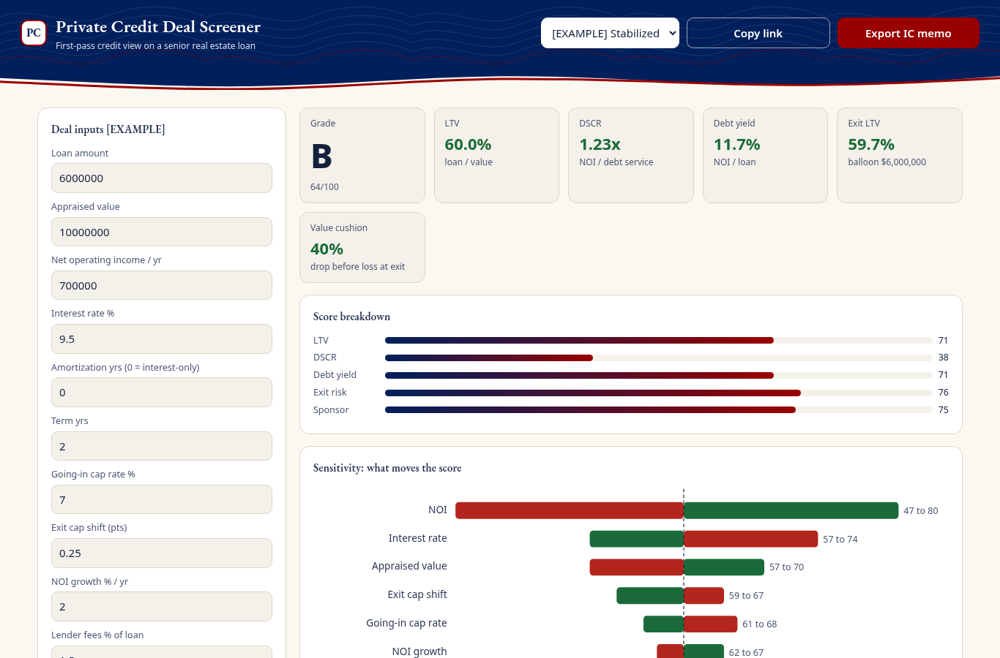
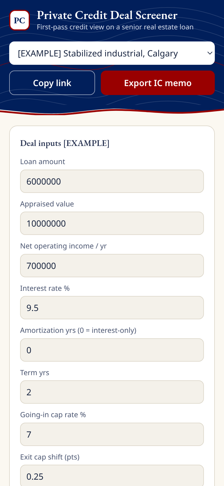

# Private Credit Deal Screener

**Live:** https://alenzacodes.github.io/private-credit-screener/

A first pass on a senior real estate loan, the kind of check you'd do before spending a day on a full credit memo. Put in the loan, the property value and the income, and it gives the deal a letter grade, shows which inputs the grade is most sensitive to, and drafts a one-page investment committee memo you can export.

## How the grade works

| Metric | Formula | Weight |
|---|---|---|
| LTV | loan / appraised value | 25% |
| DSCR | NOI / annual debt service | 25% |
| Exit LTV | balloon balance / exit value, where exit value = NOI grown over the term / (going-in cap rate + exit cap shift) | 25% |
| Debt yield | NOI / loan | 15% |
| Sponsor | your 1 to 5 rating | 10% |

The sensitivity chart moves each input up and down and shows how far the score swings, so you can see straight away whether a deal hangs on NOI, the rate or the appraisal.

The thresholds are my own screening framework, not an industry standard. Lenders set their own.

## Running it

Open `index.html` in a browser, or serve the folder with `python3 -m http.server 8000` and open http://localhost:8000/. No install. Example deals are in the dropdown at the top.

## Tests

    node tests/test.js

18 checks on debt service (amortizing and interest-only), the metrics, the scoring and the sensitivity ranges. They run on every push.

## Files

    index.html, style.css   the page
    app.js                  inputs, grade, sensitivity chart and memo
    calc.js                 debt service, metrics, scoring and sensitivity, usable in Node
    charts.js               small SVG charts, no libraries
    tests/test.js           unit tests

## Data

There's no outside data feed. Every deal in the app is a made-up example built to show the method, and the formulas are standard commercial real estate lending definitions (LTV, DSCR, debt yield, cap rate valuation). Don't enter real borrower information.

On a phone:

Educational only, not financial advice.

## Licence

MIT. Copyright 2026 John Khan.
